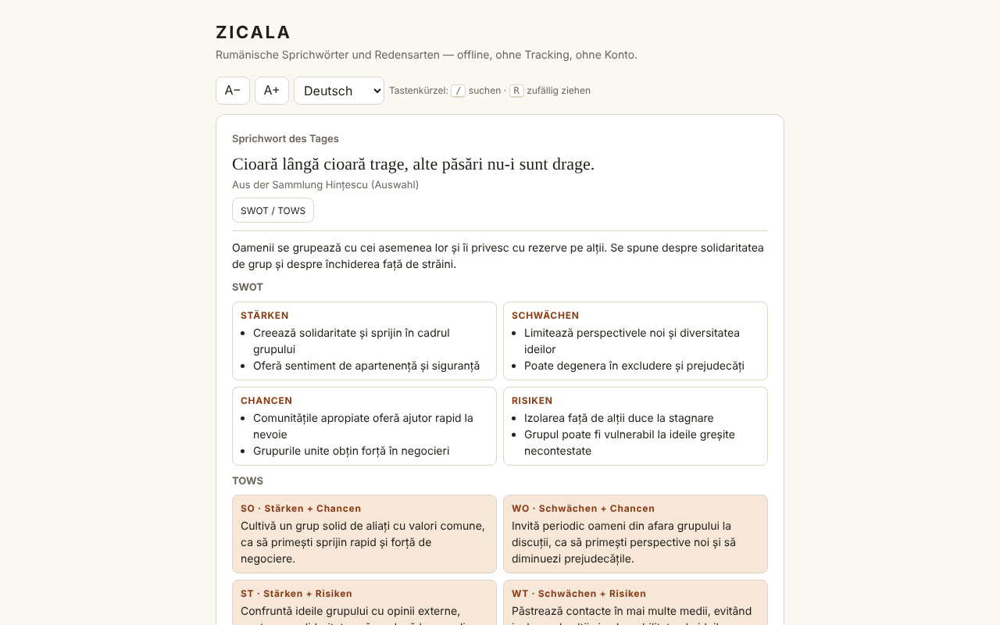

# ZICALA — rumänische Sprichwörter

[English](README.md) · [Română](README.ro.md) · [Français](README.fr.md) · [Italiano](README.it.md) · [Español](README.es.md) · [Português](README.pt.md) · **Deutsch** · [Magyar](README.hu.md)

**Version:** 1.2.9 · **Zuletzt aktualisiert:** 2026-10-26

Oberflächensprachen: **Română, English, Français, Italiano, Español, Português (PT), Deutsch, Magyar**

Eine Sammlung von 550 rumänischen Sprichwörtern und Redensarten in einer einzigen HTML-Datei: Sprichwort des Tages, Zufallsziehung, Suche, Favoriten und SWOT-/TOWS-Kommentare.

**Online:** https://chiuta.github.io/Zicala/

## Was es ist

ZICALA ist eine Offline-Anwendung („ohne Grenzen", trade-free): ohne Konto, ohne Tracking, ohne Netzwerkaufrufe. Die Sprichwörter sind in 13 Kategorien gruppiert (11 thematische, „Aus der Sammlung Hințescu (Auswahl)" und „Andere Online-Sammlungen (Auswahl)").

## Funktionen

- Sprichwort des Tages: deterministisch nach dem lokalen Datum gewählt; innerhalb eines Zyklus von 550 Tagen wiederholt sich keines.
- „Zufällig ziehen": geht alle Sprichwörter in zufälliger Reihenfolge durch (Fisher–Yates-Mischung), ohne Wiederholungen, bis die Durchgänge abgeschlossen sind; Schaltfläche „Kopieren".
- Wortsuche (alle Wörter müssen vorkommen), unempfindlich gegenüber Diakritika und Groß-/Kleinschreibung: „tacerea" findet „Tăcerea".
- Filter nach Kategorie und nach Favoriten; schrittweise angezeigte Liste (60 Zeilen, „Mehr anzeigen").
- Favoriten (★) und eigene Sprichwörter (hinzufügen/löschen), lokal gespeichert.
- Export der Favoriten und Ergänzungen in eine Textdatei und Import derselben Datei (fügt hinzu, ersetzt nicht).
- „Kopieren" bei jedem Sprichwort der Liste; Textgröße A− / A+ (4 Stufen, lokal gemerkt); Tastenkürzel: `/` für die Suche, `R` für „Zufällig ziehen" (wird nicht ausgelöst, während du in ein Feld tippst).
- Drucken: „Liste drucken" (oder Strg/Cmd+P) druckt die gesamte aktuell gefilterte Liste (zum Beispiel nur die Favoriten), schwarz-weiß, ohne Schaltflächen.
- Zu jedem Sprichwort ein Panel „SWOT / TOWS" (redaktionelle Deutung, siehe unten).

## Bedienungsanleitung

1. Öffne die Seite; das „Sprichwort des Tages" erscheint oben.
2. Drücke „Zufällig ziehen" für ein zufälliges Sprichwort; „Favorit" speichert es.
3. Gib in „Suchen" ein oder mehrere Wörter ein; wähle die Kategorie oder „Favoriten" aus den Listen.
4. Drücke „SWOT / TOWS" neben einem Sprichwort, um den Kommentar zu öffnen oder zu schließen.
5. Schreibe ein Sprichwort in „Eigenes Sprichwort hinzufügen" und drücke „Hinzufügen" (oder die Eingabetaste); „Löschen" erscheint nur bei deinen eigenen Sprichwörtern.
6. „Favoriten und Ergänzungen exportieren" lädt `zicala-export.txt` herunter; „Importieren (die exportierte Datei)" lädt sie wieder (zum Beispiel in einem anderen Browser).
7. „Kopieren" kopiert ein Sprichwort; A− / A+ ändert die Textgröße; „Liste drucken" bereitet die Seite für den Drucker vor (wähle zuerst „Favoriten", um nur die Favoriten zu drucken).

## Datenschutz und Netzwerk

- Speicher: `localStorage` (Schlüssel `zicala.zf` für Favoriten, `zicala.zm` für hinzugefügte Sprichwörter, `zicala.zs` für die Textgröße), sofern der Browser es erlaubt; andernfalls funktioniert die App, speichert aber keine Daten und warnt dich. Es werden keine Cookies, kein `sessionStorage` und keine IndexedDB verwendet.
- Netzwerk: keine externen Aufrufe. Die Seite hat eine CSP-Richtlinie (`default-src 'none'`, Skripte nur per Hash, ohne `'unsafe-inline'` für Skripte), die jede externe Verbindung oder Ressource blockiert. Die Namen der Seiten im Abschnitt „Quellen" sind reiner Text, keine Links.
- Browser-Berechtigungen: keine.

## Grenzen und Hinweise

- Die Sprichwörter selbst stehen im rumänischen Original. Die SWOT-/TOWS-Kommentare liegen in allen 8 Sprachen vor (alle 549 Analysen sind übersetzt); die Übersetzungen sind automatisch, **nicht von Muttersprachlern geprüft**, und Kommentare zu Geld, Gesundheit, Kindersicherheit oder Alkohol (und einige zu Tod oder Trauer) **müssen fachlich geprüft werden**; die App fügt keine Ratschläge hinzu.
- **SWOT / TOWS sind redaktionelle Deutungen**, KI-gestützt erzeugt, als Übung zum Nachdenken. Sie sind keine parömiologischen oder historischen Quellen; Bedeutung, Herkunft („biblisch", „lateinisch") und Zuschreibungen können ungenau sein. Sie ersetzen keinen ärztlichen, rechtlichen oder finanziellen Rat.
- Die Sammlung ist nicht erschöpfend. Für die Kategorie „Andere Online-Sammlungen" ist die genaue Quelle jedes Sprichworts nicht erfasst (allgemeine Quellen: ppli.ie, digitalpedia.ro, Enciclopedia comunei Șerbănești, proverbesicitate.blogspot.com, adevarul.ro). Die Kategorie „Hințescu" stammt aus I. C. Hințescu, *Proverbele românilor* (über ro.wikisource.org, aktualisierte Rechtschreibung).
- Volkssprichwörter sind anonym, aus der mündlichen Überlieferung; die Kommentare und Anordnungen einiger moderner Sammlungen können geschützt sein. Für Korrekturen oder Entfernungen: alexio@trom.tf.
- Einige alte Sprichwörter enthalten Stereotype oder veraltete Sprache; sie werden als Sprachdokumente beibehalten, nicht als Ermahnungen.

## Lokale Ausführung / offline

Lade `index.html` herunter und öffne sie im Browser; sie benötigt weder Server noch Internet.

## Lizenz

Die Lizenz ist noch nicht festgelegt.

## Verlauf / Changelog

- 1.2.7 — 2026-10-23: fff-kit 1.2.0: Die Browser-Schlüssel tragen jetzt das Präfix `zicala.` (`zf` → `zicala.zf`, `zm` → `zicala.zm`, `zs` → `zicala.zs`); die alten werden beim Start automatisch migriert (auch nach dem Import einer alten .fff.json-Sicherung), sodass Favoriten, hinzugefügte Sprichwörter und Textgröße erhalten bleiben. Der übrig gebliebene Verfügbarkeits-Testschlüssel `z` wird nicht mehr geschrieben (und entfernt, falls vorhanden). Das rumänische Wörterbuch enthält jetzt auch die Meldung `edRo` (symmetrische Wörterbücher in allen 8 Sprachen).
- 1.2.5 — 2026-10-22: fff-kit 1.1.4: Touch-Ziele und Mindestschriftgröße; Touch-Ziele/Text korrigiert
- 1.2.4 — 2026-10-22: fff-kit 1.1.2: PBKDF2 mit 600.000 Iterationen, Schutz vor Clickjacking.
- 1.2.3 — 2026-10-22: **Korrektur**: die Schaltfläche „Kopieren“ folgt jetzt der gewählten Sprache.
- 1.2.2 — 2026-10-19: alle 549 SWOT-/TOWS-Analysen sind nach en, fr, it, es, pt, de, hu übersetzt; die Hinweise sagen nicht mehr, dass der Rest auf Rumänisch bleibt. Die Sprichwörter bleiben auf Rumänisch.

- 1.1.0 — 2026-10-14: Datensicherung und Datenkennzeichnung (fff-kit).

- 1.0.0 — 2026-10-12: Version und Datum der letzten Aktualisierung werden in der App angezeigt (erste nummerierte Version; in der Infokarte unter der Liste).

Runde 7:
- **Import:** Die Schaltfläche „Importieren (die exportierte Datei)" liest `zicala-export.txt` (die Abschnitte `FAVORITE` und `ADĂUGATE DE MINE`) und **fügt** die Favoriten hinzu (nur für Sprichwörter, die in der Sammlung vorhanden oder soeben importiert sind) sowie die neuen eigenen Sprichwörter; sie löscht nichts, ignoriert Duplikate, beachtet die Grenzen (8–300 Zeichen, Datei ≤ 200 KB) und zeigt an, wie viele hinzugefügt/übersprungen wurden. Zuvor konnte der Export nicht wieder geladen werden (Daten ließen sich nicht zwischen Browsern verschieben). CSP-Hash neu berechnet; axe-core = 0 Verstöße bei 1280 und 360 px.
- Der Inhalt (Sprichwörter, SWOT/TOWS) wurde nicht verändert.

Runde 6:
- Neu: „Kopieren" in jeder Zeile, A− / A+, Kürzel `/` und `R`, „Liste drucken" mit Druckformatierung. CSP: Das Skript wird jetzt per Hash statt per `'unsafe-inline'` erlaubt. Die SWOT/TOWS-Panels verwenden `h3` (richtige Überschriftenfolge); die Kategorienliste läuft bei vergrößertem Text nicht mehr über den 360-px-Bildschirm hinaus. Screenshot aufgefrischt.
- Routineprüfung: axe-core = 0 Verstöße bei 1280 und 360 px, 0 JS-Fehler, kein horizontaler Überlauf; das Sprichwort des Tages wird aus dem lokalen Datum berechnet und braucht daher keine Aktualisierung. Keine Codeänderungen.

## Autor

Alexio — Alexandru-Ionuț Chiuță, Kontakt: alexio@trom.tf

## Zusammenfassung

ZICALA ist eine Offline-Sammlung von 550 rumänischen Sprichwörtern in einer einzigen Datei: Sprichwort des Tages, Zufallsziehung (Fisher–Yates), diakritikunempfindliche Suche, Favoriten und vom Nutzer hinzugefügte Sprichwörter (localStorage, mit sanftem Rückfall). Sie stellt keine Netzwerkanfragen (strikte CSP) und fordert keine Berechtigungen an. Die SWOT/TOWS-Panels zu jedem Sprichwort sind redaktionelle, KI-gestützte Deutungen, keine wissenschaftlichen Quellen. Die Quellenangabe ist allgemein; die Herkunft einzelner Einträge ist nicht erfasst. Noch keine Lizenz festgelegt.
