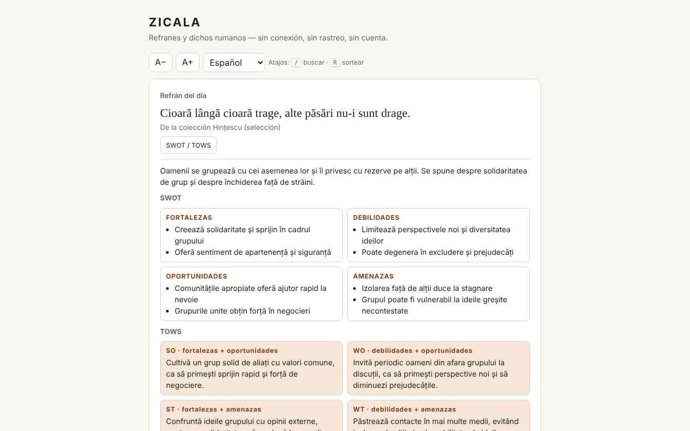

# ZICALA — proverbios rumanos

[English](README.md) · [Română](README.ro.md) · [Français](README.fr.md) · [Italiano](README.it.md) · **Español** · [Português](README.pt.md) · [Deutsch](README.de.md) · [Magyar](README.hu.md)

**Versión:** 1.2.1 · **Última actualización:** 2026-10-19

Idiomas de la interfaz: **Română, English, Français, Italiano, Español, Português (PT), Deutsch, Magyar**

Una colección de 550 proverbios y dichos rumanos en un único archivo HTML: proverbio del día, sorteo al azar, búsqueda, favoritos y comentarios SWOT / TOWS.

**En línea:** https://chiuta.github.io/Zicala/

## Qué es

ZICALA es una aplicación sin conexión («sin fronteras», trade-free): sin cuenta, sin rastreo, sin llamadas de red. Los proverbios están agrupados en 13 categorías (11 temáticas, «De la recopilación Hințescu (selección)» y «Otras recopilaciones en línea (selección)»).

## Funciones

- Proverbio del día: elegido de forma determinista según la fecha local; en un ciclo de 550 días no se repite ninguno.
- «Sortear»: recorre todos los proverbios en orden aleatorio (mezcla de Fisher–Yates), sin repeticiones hasta que terminan las rondas; botón «Copiar».
- Búsqueda por palabras (deben aparecer todas), insensible a los signos diacríticos y a las mayúsculas: «tacerea» encuentra «Tăcerea».
- Filtro por categoría y por favoritos; lista mostrada de forma progresiva (60 filas, «Mostrar más»).
- Favoritos (★) y proverbios propios (añadir/eliminar), guardados en local.
- Exportación de los favoritos y las adiciones a un archivo de texto e importación del mismo archivo (añade, no reemplaza).
- «Copiar» en cada proverbio de la lista; tamaño del texto A− / A+ (4 niveles, recordado en local); atajos de teclado: `/` para buscar, `R` para «Sortear» (no se activa mientras escribes en un campo).
- Impresión: «Imprimir la lista» (o Ctrl/Cmd+P) imprime toda la lista filtrada en ese momento (por ejemplo, solo los favoritos), en blanco y negro, sin botones.
- Para cada proverbio, un panel «SWOT / TOWS» (interpretación editorial, véase más abajo).

## Guía de uso

1. Abre la página; el «Proverbio del día» aparece arriba.
2. Pulsa «Sortear» para un proverbio al azar; «Favorito» lo guarda.
3. Escribe una o varias palabras en «Buscar»; elige la categoría o «Favoritos» en las listas.
4. Pulsa «SWOT / TOWS» junto a un proverbio para abrir o cerrar el comentario.
5. Escribe un proverbio en «Añade un proverbio propio» y pulsa «Añadir» (o Intro); «Eliminar» aparece solo en tus propios proverbios.
6. «Exportar favoritos y adiciones» descarga `zicala-export.txt`; «Importar (el archivo exportado)» lo vuelve a cargar (por ejemplo, en otro navegador).
7. «Copiar» copia un proverbio; A− / A+ cambia el tamaño del texto; «Imprimir la lista» prepara la página para la impresora (elige antes «Favoritos» para imprimir solo los favoritos).

## Privacidad y red

- Almacenamiento: `localStorage` (claves `zf` para los favoritos, `zm` para los proverbios añadidos, `zs` para el tamaño del texto), si el navegador lo permite; de lo contrario, la aplicación funciona pero no conserva los datos y te avisa. No se usan cookies, `sessionStorage` ni IndexedDB.
- Red: ninguna llamada externa. La página tiene una política CSP (`default-src 'none'`, scripts solo mediante hash, sin `'unsafe-inline'` para scripts) que bloquea cualquier conexión o recurso externo. Los nombres de los sitios de la sección «Fuentes» son solo texto, no enlaces.
- Permisos del navegador: ninguno.

## Límites y advertencias

- **Los SWOT / TOWS son interpretaciones editoriales**, generadas con asistencia de IA, como ejercicio de reflexión. No son fuentes paremiológicas ni históricas; el sentido, el origen («bíblico», «latino») y las atribuciones pueden ser inexactos. No sustituyen el consejo médico, jurídico ni financiero.
- La colección no es exhaustiva. Para la categoría «Otras recopilaciones en línea» no se registra la fuente exacta de cada proverbio (fuentes generales: ppli.ie, digitalpedia.ro, Enciclopedia comunei Șerbănești, proverbesicitate.blogspot.com, adevarul.ro). La categoría «Hințescu» procede de I. C. Hințescu, *Proverbele românilor* (a través de ro.wikisource.org, ortografía actualizada).
- Los proverbios populares son anónimos, de tradición oral; los comentarios y las ordenaciones de algunas recopilaciones modernas pueden estar protegidos. Para correcciones o retiradas: alexio@trom.tf.
- Algunos proverbios antiguos contienen estereotipos o lenguaje anticuado; se conservan como documentos de la lengua, no como exhortaciones.

## Ejecución local / sin conexión

Descarga `index.html` y ábrelo en un navegador; no necesita servidor ni internet.

## Licencia

La licencia aún no está declarada.

## Historial / Changelog

- 1.1.0 — 2026-10-14: copia de seguridad y etiquetado de datos (fff-kit).

- 1.0.0 — 2026-10-12: la versión y la fecha de la última actualización se muestran en la aplicación (primera versión numerada; en la tarjeta informativa bajo la lista).

Ronda 7:
- **Importación:** el botón «Importar (el archivo exportado)» lee `zicala-export.txt` (las secciones `FAVORITE` y `ADĂUGATE DE MINE`) y **añade** los favoritos (solo para proverbios existentes en la colección o recién importados) y los nuevos proverbios propios; no elimina nada, ignora los duplicados, respeta los límites (8–300 caracteres, archivo ≤ 200 KB) y muestra cuántos se añadieron/omitieron. Antes, la exportación no se podía volver a cargar (los datos no podían moverse entre navegadores). Hash CSP recalculado; axe-core = 0 infracciones a 1280 y 360 px.
- El contenido (proverbios, SWOT/TOWS) no se modificó.

Ronda 6:
- Novedad: «Copiar» en cada fila, A− / A+, atajos `/` y `R`, «Imprimir la lista» con estilo de impresión. CSP: el script se permite ahora mediante hash en lugar de `'unsafe-inline'`. Los paneles SWOT/TOWS usan `h3` (orden correcto de los títulos); la lista de categorías ya no se sale de la pantalla de 360 px con el texto ampliado. Captura de pantalla renovada.
- Verificación de rutina: axe-core = 0 infracciones a 1280 y 360 px, 0 errores JS, sin desbordamiento horizontal; el proverbio del día se calcula a partir de la fecha local, por lo que no necesita actualización. Sin cambios de código.

## Autor

Alexio — Alexandru-Ionuț Chiuță, contacto: alexio@trom.tf

## Resumen

ZICALA es una colección sin conexión, de un solo archivo, de 550 proverbios rumanos: proverbio del día, sorteo al azar (Fisher–Yates), búsqueda insensible a los signos diacríticos, favoritos y proverbios añadidos por el usuario (localStorage, con degradación elegante). No realiza solicitudes de red (CSP estricta) y no pide permisos. Los paneles SWOT/TOWS de cada proverbio son interpretaciones editoriales asistidas por IA, no fuentes académicas. La atribución de fuentes es general; no se registra la procedencia de cada elemento. Todavía no se ha declarado ninguna licencia.
