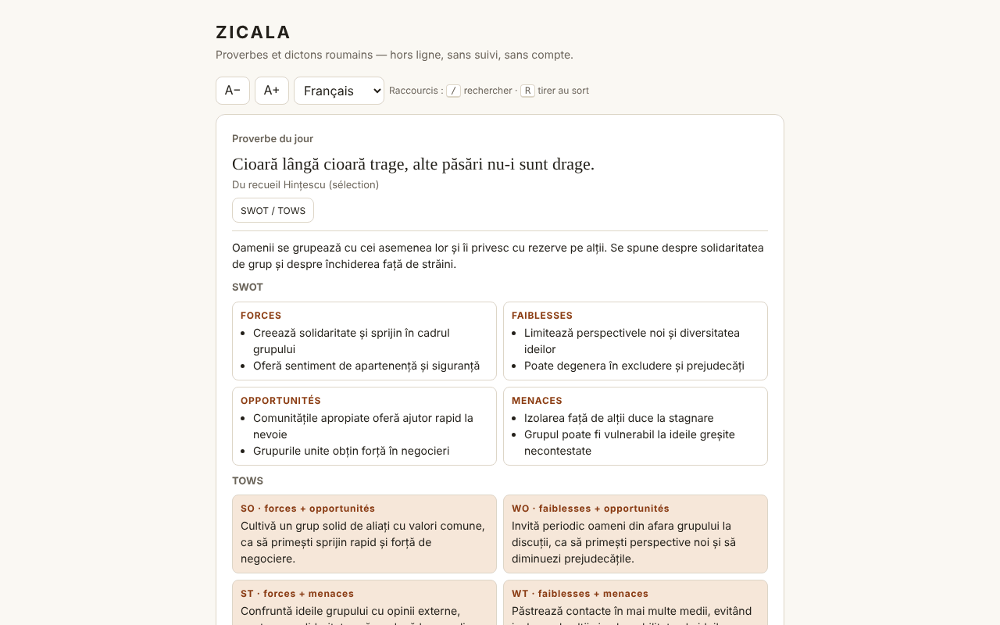

# ZICALA — proverbes roumains

[English](README.md) · [Română](README.ro.md) · **Français** · [Italiano](README.it.md) · [Español](README.es.md) · [Português](README.pt.md) · [Deutsch](README.de.md) · [Magyar](README.hu.md)

**Version :** 1.2.7 · **Dernière mise à jour :** 2026-10-23

Langues de l'interface : **Română, English, Français, Italiano, Español, Português (PT), Deutsch, Magyar**

Une collection de 550 proverbes et dictons roumains dans un seul fichier HTML : proverbe du jour, tirage au sort, recherche, favoris et commentaires SWOT / TOWS.

**En ligne :** https://chiuta.github.io/Zicala/

## De quoi s'agit-il

ZICALA est une application hors ligne (« sans frontières », trade-free) : sans compte, sans pistage, sans appel réseau. Les proverbes sont regroupés en 13 catégories (11 thématiques, « Du recueil Hințescu (sélection) » et « Autres recueils en ligne (sélection) »).

## Fonctionnalités

- Proverbe du jour : choisi de façon déterministe d'après la date locale ; sur un cycle de 550 jours, aucun ne se répète.
- « Tirer au sort » : parcourt tous les proverbes dans un ordre aléatoire (mélange de Fisher–Yates), sans répétition jusqu'à la fin des tours ; bouton « Copier ».
- Recherche par mots (tous les mots doivent apparaître), insensible aux diacritiques et à la casse : « tacerea » trouve « Tăcerea ».
- Filtre par catégorie et par favoris ; liste affichée progressivement (60 lignes, « Afficher plus »).
- Favoris (★) et proverbes personnels (ajout/suppression), enregistrés localement.
- Export des favoris et des ajouts dans un fichier texte et import du même fichier (ajoute, ne remplace pas).
- « Copier » sur chaque proverbe de la liste ; taille du texte A− / A+ (4 niveaux, mémorisée localement) ; raccourcis clavier : `/` pour la recherche, `R` pour « Tirer au sort » (ne se déclenche pas lorsque vous saisissez du texte dans un champ).
- Impression : « Imprimer la liste » (ou Ctrl/Cmd+P) imprime toute la liste actuellement filtrée (par exemple uniquement les favoris), en noir et blanc, sans boutons.
- Pour chaque proverbe, un panneau « SWOT / TOWS » (interprétation éditoriale, voir plus bas).

## Mode d'emploi

1. Ouvrez la page ; le « Proverbe du jour » apparaît en haut.
2. Appuyez sur « Tirer au sort » pour un proverbe aléatoire ; « Favori » l'enregistre.
3. Saisissez un ou plusieurs mots dans « Rechercher » ; choisissez la catégorie ou « Favoris » dans les listes.
4. Appuyez sur « SWOT / TOWS » à côté d'un proverbe pour ouvrir ou fermer le commentaire.
5. Saisissez un proverbe dans « Ajouter un proverbe de votre cru » et appuyez sur « Ajouter » (ou Entrée) ; « Supprimer » n'apparaît que pour vos propres proverbes.
6. « Exporter les favoris et les ajouts » télécharge `zicala-export.txt` ; « Importer (le fichier exporté) » le recharge (par exemple dans un autre navigateur).
7. « Copier » copie un proverbe ; A− / A+ change la taille du texte ; « Imprimer la liste » prépare la page pour l'imprimante (choisissez d'abord « Favoris » pour n'imprimer que les favoris).

## Confidentialité et réseau

- Stockage : `localStorage` (clés `zicala.zf` pour les favoris, `zicala.zm` pour les proverbes ajoutés, `zicala.zs` pour la taille du texte), si le navigateur l'autorise ; sinon l'application fonctionne mais ne conserve pas les données et vous en avertit. Aucun cookie, `sessionStorage` ou IndexedDB n'est utilisé.
- Réseau : aucun appel externe. La page a une politique CSP (`default-src 'none'`, scripts uniquement par empreinte, sans `'unsafe-inline'` pour les scripts) qui bloque toute connexion ou ressource externe. Les noms des sites de la section « Sources » sont du simple texte, pas des liens.
- Autorisations du navigateur : aucune.

## Limites et avertissements

- Les proverbes eux-mêmes sont donnés en roumain, la langue d'origine. Les commentaires SWOT / TOWS existent dans les 8 langues (les 549 analyses sont traduites) ; les traductions sont automatiques, **non vérifiées par des locuteurs natifs**, et les commentaires touchant à l'argent, à la santé, à la sécurité des enfants ou à l'alcool (et quelques-uns sur la mort ou le deuil) **doivent être relus par un spécialiste** ; l'application n'ajoute aucun conseil.
- **Les SWOT / TOWS sont des interprétations éditoriales**, générées avec l'aide de l'IA, comme exercice de réflexion. Ce ne sont pas des sources parémiologiques ou historiques ; le sens, l'origine (« biblique », « latine ») et les attributions peuvent être inexacts. Ils ne remplacent pas un avis médical, juridique ou financier.
- La collection n'est pas exhaustive. Pour la catégorie « Autres recueils en ligne », la source exacte de chaque proverbe n'est pas enregistrée (sources générales : ppli.ie, digitalpedia.ro, Enciclopedia comunei Șerbănești, proverbesicitate.blogspot.com, adevarul.ro). La catégorie « Hințescu » provient de I. C. Hințescu, *Proverbele românilor* (via ro.wikisource.org, orthographe actualisée).
- Les proverbes populaires sont anonymes, issus de la tradition orale ; les commentaires et les agencements de certains recueils modernes peuvent être protégés. Pour toute correction ou tout retrait : alexio@trom.tf.
- Certains proverbes anciens contiennent des stéréotypes ou un langage dépassé ; ils sont conservés comme documents de langue, non comme exhortations.

## Exécution en local / hors ligne

Téléchargez `index.html` et ouvrez-le dans un navigateur ; il n'a besoin ni de serveur ni d'internet.

## Licence

La licence n'est pas encore déclarée.

## Historique / Changelog

- 1.2.7 — 2026-10-23: fff-kit 1.2.0 : les clés du navigateur portent désormais le préfixe `zicala.` (`zf` → `zicala.zf`, `zm` → `zicala.zm`, `zs` → `zicala.zs`) ; les anciennes sont migrées automatiquement au démarrage (y compris après l'import d'une ancienne sauvegarde .fff.json) : favoris, proverbes ajoutés et taille du texte sont conservés. La clé-sonde `z`, reliquat du test de disponibilité, n'est plus écrite (et est supprimée si elle existe). Le dictionnaire roumain contient aussi le message `edRo` (dictionnaires symétriques dans les 8 langues).
- 1.2.5 — 2026-10-22 : fff-kit 1.1.4 : cibles tactiles et taille de texte minimale; cibles tactiles/texte corrigés
- 1.2.4 — 2026-10-22 : fff-kit 1.1.2 : PBKDF2 à 600 000 itérations, protection anti-clickjacking.
- 1.2.3 — 2026-10-22: **correctif** : le bouton « Copier » suit désormais la langue choisie.
- 1.2.2 — 2026-10-19 : les 549 analyses SWOT / TOWS sont traduites en en, fr, it, es, pt, de, hu ; les notes ne disent plus que le reste demeure en roumain. Les proverbes restent en roumain.

- 1.1.0 — 2026-10-14 : sauvegarde et étiquetage des données (fff-kit).

- 1.0.0 — 2026-10-12 : la version et la date de la dernière mise à jour sont affichées dans l'application (première version numérotée ; dans la carte d'information sous la liste).

Série 7 :
- **Import :** le bouton « Importer (le fichier exporté) » lit `zicala-export.txt` (les sections `FAVORITE` et `ADĂUGATE DE MINE`) et **ajoute** les favoris (uniquement pour les proverbes existant dans la collection ou tout juste importés) ainsi que les nouveaux proverbes personnels ; il ne supprime rien, ignore les doublons, respecte les limites (8–300 caractères, fichier ≤ 200 Ko) et indique combien ont été ajoutés/ignorés. Auparavant, l'export ne pouvait pas être rechargé (les données ne pouvaient pas être déplacées d'un navigateur à l'autre). Empreinte CSP recalculée ; axe-core = 0 violation à 1280 et 360 px.
- Le contenu (proverbes, SWOT/TOWS) n'a pas été modifié.

Série 6 :
- Nouveau : « Copier » sur chaque ligne, A− / A+, raccourcis `/` et `R`, « Imprimer la liste » avec une feuille de style d'impression. CSP : le script est désormais autorisé par empreinte au lieu de `'unsafe-inline'`. Les panneaux SWOT/TOWS utilisent `h3` (ordre correct des titres) ; la liste des catégories ne déborde plus de l'écran de 360 px avec un texte agrandi. Capture d'écran actualisée.
- Vérification de routine : axe-core = 0 violation à 1280 et 360 px, 0 erreur JS, pas de débordement horizontal ; le proverbe du jour est calculé d'après la date locale, il n'a donc pas besoin d'être mis à jour. Aucune modification du code.

## Auteur

Alexio — Alexandru-Ionuț Chiuță, contact : alexio@trom.tf

## Résumé

ZICALA est une collection hors ligne, en un seul fichier, de 550 proverbes roumains : proverbe du jour, tirage au sort (Fisher–Yates), recherche insensible aux diacritiques, favoris et proverbes ajoutés par l'utilisateur (localStorage, avec repli gracieux). Elle n'effectue aucune requête réseau (CSP stricte) et ne demande aucune autorisation. Les panneaux SWOT/TOWS de chaque proverbe sont des interprétations éditoriales assistées par IA, et non des sources scientifiques. L'attribution des sources est générale ; la provenance de chaque élément n'est pas enregistrée. Aucune licence n'est encore déclarée.
