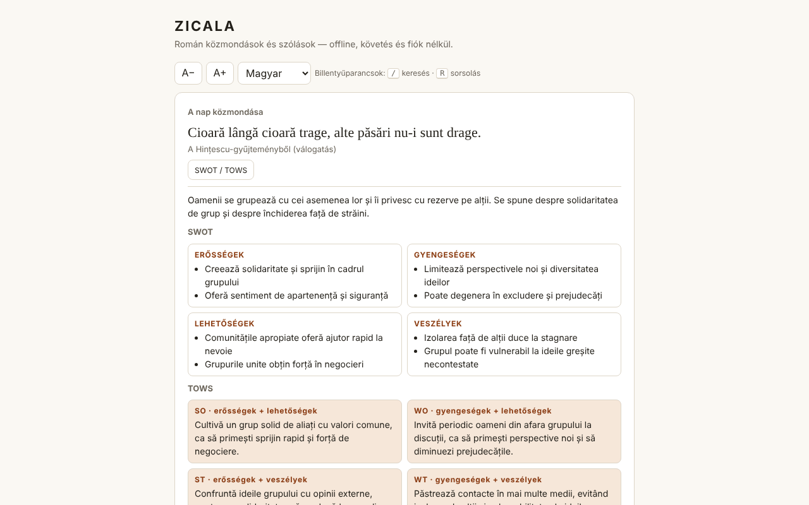

# ZICALA — román közmondások

[English](README.md) · [Română](README.ro.md) · [Français](README.fr.md) · [Italiano](README.it.md) · [Español](README.es.md) · [Português](README.pt.md) · [Deutsch](README.de.md) · **Magyar**

**Verzió:** 1.2.0 · **Utolsó frissítés:** 2026-10-19

A felület nyelvei: **Română, English, Français, Italiano, Español, Português (PT), Deutsch, Magyar**

550 román közmondás és szólás gyűjteménye egyetlen HTML-fájlban: a nap közmondása, véletlen húzás, keresés, kedvencek, valamint SWOT / TOWS kommentárok.

**Élő változat:** https://chiuta.github.io/Zicala/

## Mi ez

A ZICALA offline („határok nélküli", trade-free) alkalmazás: fiókot nem kér, nem követ, hálózati hívásokat nem végez. A közmondások 13 kategóriába vannak csoportosítva (11 tematikus, „A Hințescu-gyűjteményből (válogatás)” és „Más online gyűjtemények (válogatás)”).

## Funkciók

- A nap közmondása: a helyi dátum alapján, determinisztikusan kiválasztva; 550 napos cikluson belül egy sem ismétlődik.
- „Húzás”: az összes közmondáson véletlen sorrendben halad végig (Fisher–Yates-keverés), ismétlés nélkül, amíg a körök véget nem érnek; „Másolás” gomb.
- Szavas keresés (minden szónak szerepelnie kell), érzéketlen az ékezetekre és a kis-/nagybetűkre: a „tacerea” megtalálja a „Tăcerea” szót.
- Szűrés kategória és kedvencek szerint; fokozatosan megjelenített lista (60 sor, „Még több”).
- Kedvencek (★) és saját közmondások (hozzáadás/törlés), helyben mentve.
- A kedvencek és a hozzáadások exportálása szövegfájlba, ugyanannak a fájlnak az importálása (hozzáad, nem cserél).
- „Másolás” a lista minden közmondásánál; betűméret A− / A+ (4 fokozat, helyben megjegyezve); billentyűparancsok: `/` a kereséshez, `R` a „Húzás”-hoz (nem aktiválódik, amíg egy mezőbe gépelsz).
- Nyomtatás: a „Lista nyomtatása” (vagy Ctrl/Cmd+P) a jelenleg szűrt teljes listát nyomtatja (például csak a kedvenceket), fekete-fehérben, gombok nélkül.
- Minden közmondáshoz egy „SWOT / TOWS” panel (szerkesztői értelmezés, lásd lent).

## Használati útmutató

1. Nyisd meg az oldalt; a „A nap közmondása” felül jelenik meg.
2. Nyomd meg a „Húzás” gombot egy véletlen közmondásért; a „Kedvenc” elmenti.
3. Írj be egy vagy több szót a „Keresés” mezőbe; válaszd ki a kategóriát vagy a „Kedvencek” elemet a listákból.
4. Nyomd meg a „SWOT / TOWS” gombot egy közmondás mellett a kommentár megnyitásához vagy bezárásához.
5. Írj be egy közmondást a „Add hozzá a saját közmondásodat” mezőbe, és nyomd meg a „Hozzáadás” gombot (vagy az Entert); a „Törlés” csak a saját közmondásaidnál jelenik meg.
6. A „Kedvencek és hozzáadások exportálása” letölti a `zicala-export.txt` fájlt; az „Importálás (az exportált fájl)” újra betölti (például egy másik böngészőben).
7. A „Másolás” egy közmondást másol; az A− / A+ a betűméretet változtatja; a „Lista nyomtatása” előkészíti az oldalt a nyomtatóhoz (előbb válaszd a „Kedvencek” elemet, ha csak a kedvenceket akarod nyomtatni).

## Adatvédelem és hálózat

- Tárolás: `localStorage` (a `zf` kulcs a kedvenceknek, a `zm` a hozzáadott közmondásoknak, a `zs` a betűméretnek), ha a böngésző engedi; ellenkező esetben az alkalmazás működik, de nem őrzi meg az adatokat, és figyelmeztet erre. Nem használ sütiket, `sessionStorage`-ot vagy IndexedDB-t.
- Hálózat: nincs külső hívás. Az oldalon CSP-szabályzat van (`default-src 'none'`, szkriptek csak hash alapján, a szkriptekhez `'unsafe-inline'` nélkül), amely blokkol minden külső kapcsolatot vagy erőforrást. A „Források” szakaszban szereplő oldalak nevei csak szövegek, nem hivatkozások.
- Böngészőengedélyek: nincs.

## Korlátok és figyelmeztetések

- **A SWOT / TOWS szerkesztői értelmezések**, mesterséges intelligencia segítségével készültek, gondolkodtató gyakorlatként. Nem paremiológiai vagy történeti források; a jelentés, az eredet („bibliai", „latin") és az attribúciók pontatlanok lehetnek. Nem helyettesítik az orvosi, jogi vagy pénzügyi tanácsot.
- A gyűjtemény nem teljes körű. A „Más online gyűjtemények” kategóriánál az egyes közmondások pontos forrása nincs rögzítve (általános források: ppli.ie, digitalpedia.ro, Enciclopedia comunei Șerbănești, proverbesicitate.blogspot.com, adevarul.ro). A „Hințescu” kategória I. C. Hințescu *Proverbele românilor* című művéből származik (a ro.wikisource.org útján, frissített helyesírással).
- A népi közmondások névtelenek, szájhagyományból erednek; néhány modern gyűjtemény kommentárjai és elrendezései védettek lehetnek. Javításokhoz vagy eltávolításhoz: alexio@trom.tf.
- Néhány régi közmondás sztereotípiákat vagy elavult nyelvezetet tartalmaz; nyelvi dokumentumként maradtak meg, nem buzdításként.

## Futtatás helyben / offline

Töltsd le az `index.html` fájlt, és nyisd meg böngészőben; nincs szüksége szerverre vagy internetre.

## Licenc

A licenc még nincs megadva.

## Előzmények / Changelog

- 1.1.0 — 2026-10-14: biztonsági mentés és adatcímkézés (fff-kit).

- 1.0.0 — 2026-10-12: a verzió és az utolsó frissítés dátuma megjelenik az alkalmazásban (első számozott verzió; a lista alatti információs kártyán).

7. kör:
- **Importálás:** az „Importálás (az exportált fájl)” gomb beolvassa a `zicala-export.txt` fájlt (a `FAVORITE` és `ADĂUGATE DE MINE` szakaszokat), és **hozzáadja** a kedvenceket (csak a gyűjteményben meglévő vagy éppen importált közmondásokhoz) és az új saját közmondásokat; semmit sem töröl, figyelmen kívül hagyja az ismétlődéseket, betartja a korlátokat (8–300 karakter, fájl ≤ 200 KB), és kiírja, hány elemet adott hozzá/hagyott ki. Korábban az exportot nem lehetett újratölteni (az adatokat nem lehetett böngészők között áthelyezni). A CSP-hash újraszámolva; axe-core = 0 szabálysértés 1280 és 360 px-en.
- A tartalom (közmondások, SWOT/TOWS) nem módosult.

6. kör:
- Új: „Másolás” minden soron, A− / A+, `/` és `R` billentyűparancsok, „Lista nyomtatása” nyomtatási stílussal. CSP: a szkriptet mostantól hash engedélyezi az `'unsafe-inline'` helyett. A SWOT/TOWS panelek `h3`-at használnak (helyes címsorrend); a kategórialista megnövelt szövegnél sem lóg ki a 360 px-es képernyőről. A képernyőkép frissítve.
- Rutinellenőrzés: axe-core = 0 szabálysértés 1280 és 360 px-en, 0 JS-hiba, nincs vízszintes túlnyúlás; a nap közmondása a helyi dátumból számolódik, ezért nem igényel frissítést. Nem volt kódmódosítás.

## Szerző

Alexio — Alexandru-Ionuț Chiuță, elérhetőség: alexio@trom.tf

## Összefoglaló

A ZICALA 550 román közmondás egyfájlos, offline gyűjteménye: a nap közmondása, véletlen húzás (Fisher–Yates), ékezetekre érzéketlen keresés, kedvencek és a felhasználó által hozzáadott közmondások (localStorage, kíméletes visszaesési móddal). Nem küld hálózati kéréseket (szigorú CSP), és nem kér engedélyeket. A közmondásonkénti SWOT/TOWS panelek szerkesztői, mesterséges intelligencia segítségével készült értelmezések, nem tudományos források. A forrásmegjelölés általános; az egyes elemek eredete nincs rögzítve. Licenc még nincs megadva.
