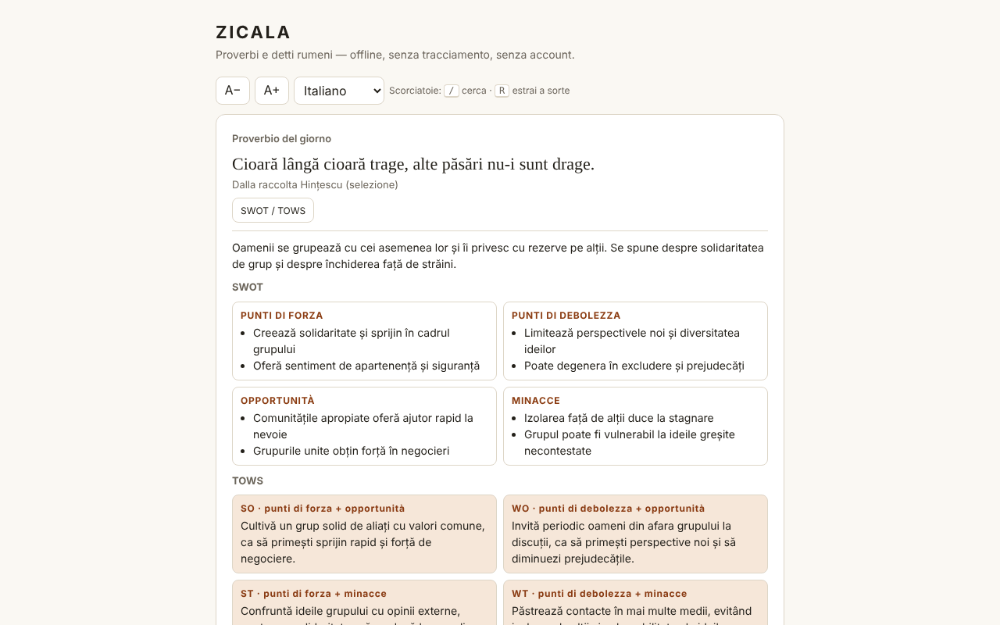

# ZICALA — proverbi rumeni

[English](README.md) · [Română](README.ro.md) · [Français](README.fr.md) · **Italiano** · [Español](README.es.md) · [Português](README.pt.md) · [Deutsch](README.de.md) · [Magyar](README.hu.md)

**Versione:** 1.2.8 · **Ultimo aggiornamento:** 2026-10-23

Lingue dell'interfaccia: **Română, English, Français, Italiano, Español, Português (PT), Deutsch, Magyar**

Una raccolta di 550 proverbi e detti rumeni in un unico file HTML: proverbio del giorno, estrazione a sorte, ricerca, preferiti e commenti SWOT / TOWS.

**Online:** https://chiuta.github.io/Zicala/

## Che cos'è

ZICALA è un'applicazione offline («senza frontiere», trade-free): senza account, senza tracciamento, senza chiamate di rete. I proverbi sono raggruppati in 13 categorie (11 tematiche, «Dalla raccolta Hințescu (selezione)» e «Altre raccolte online (selezione)»).

## Funzioni

- Proverbio del giorno: scelto in modo deterministico in base alla data locale; in un ciclo di 550 giorni non se ne ripete nessuno.
- «Estrai a sorte»: scorre tutti i proverbi in ordine casuale (rimescolamento di Fisher–Yates), senza ripetizioni finché i giri non sono terminati; pulsante «Copia».
- Ricerca per parole (devono comparire tutte), insensibile ai segni diacritici e alle maiuscole: «tacerea» trova «Tăcerea».
- Filtro per categoria e per preferiti; elenco mostrato progressivamente (60 righe, «Mostra altri»).
- Preferiti (★) e proverbi propri (aggiunta/eliminazione), salvati in locale.
- Esportazione dei preferiti e delle aggiunte in un file di testo e importazione dello stesso file (aggiunge, non sostituisce).
- «Copia» su ogni proverbio dell'elenco; dimensione del testo A− / A+ (4 livelli, memorizzata in locale); scorciatoie da tastiera: `/` per la ricerca, `R` per «Estrai a sorte» (non si attiva mentre scrivi in un campo).
- Stampa: «Stampa l'elenco» (o Ctrl/Cmd+P) stampa l'intero elenco attualmente filtrato (ad esempio solo i preferiti), in bianco e nero, senza pulsanti.
- Per ogni proverbio, un pannello «SWOT / TOWS» (interpretazione editoriale, vedi sotto).

## Guida all'uso

1. Apri la pagina; il «Proverbio del giorno» compare in alto.
2. Premi «Estrai a sorte» per un proverbio casuale; «Preferito» lo salva.
3. Scrivi una o più parole in «Cerca»; scegli la categoria o «Preferiti» dagli elenchi.
4. Premi «SWOT / TOWS» accanto a un proverbio per aprire o chiudere il commento.
5. Scrivi un proverbio in «Aggiungi un tuo proverbio» e premi «Aggiungi» (o Invio); «Elimina» compare solo sui tuoi proverbi.
6. «Esporta preferiti e aggiunte» scarica `zicala-export.txt`; «Importa (il file esportato)» lo ricarica (ad esempio in un altro browser).
7. «Copia» copia un proverbio; A− / A+ cambia la dimensione del testo; «Stampa l'elenco» prepara la pagina per la stampante (scegli prima «Preferiti» per stampare solo i preferiti).

## Privacy e rete

- Archiviazione: `localStorage` (chiavi `zicala.zf` per i preferiti, `zicala.zm` per i proverbi aggiunti, `zicala.zs` per la dimensione del testo), se il browser lo consente; altrimenti l'app funziona ma non conserva i dati e ti avvisa. Non si usano cookie, `sessionStorage` né IndexedDB.
- Rete: nessuna chiamata esterna. La pagina ha una politica CSP (`default-src 'none'`, script solo tramite hash, senza `'unsafe-inline'` per gli script) che blocca qualsiasi connessione o risorsa esterna. I nomi dei siti nella sezione «Fonti» sono semplice testo, non link.
- Permessi del browser: nessuno.

## Limiti e avvertenze

- I proverbi stessi sono dati in rumeno, la lingua originale. I commenti SWOT / TOWS esistono in tutte le 8 lingue (tutte le 549 analisi sono tradotte); le traduzioni sono automatiche, **non verificate da madrelingua**, e i commenti che toccano denaro, salute, sicurezza dei bambini o alcol (e alcuni su morte o lutto) **richiedono la revisione di uno specialista**; l'app non aggiunge alcun consiglio.
- **Gli SWOT / TOWS sono interpretazioni editoriali**, generate con l'assistenza dell'IA, come esercizio di riflessione. Non sono fonti paremiologiche o storiche; il significato, l'origine («biblica», «latina») e le attribuzioni possono essere inesatti. Non sostituiscono la consulenza medica, legale o finanziaria.
- La raccolta non è esaustiva. Per la categoria «Altre raccolte online» la fonte esatta di ciascun proverbio non è registrata (fonti generali: ppli.ie, digitalpedia.ro, Enciclopedia comunei Șerbănești, proverbesicitate.blogspot.com, adevarul.ro). La categoria «Hințescu» proviene da I. C. Hințescu, *Proverbele românilor* (tramite ro.wikisource.org, ortografia aggiornata).
- I proverbi popolari sono anonimi, di tradizione orale; i commenti e gli ordinamenti di alcune raccolte moderne possono essere protetti. Per correzioni o rimozioni: alexio@trom.tf.
- Alcuni proverbi antichi contengono stereotipi o un linguaggio superato; sono conservati come documenti linguistici, non come esortazioni.

## Esecuzione locale / offline

Scarica `index.html` e aprilo nel browser; non ha bisogno di server né di internet.

## Licenza

La licenza non è ancora dichiarata.

## Cronologia / Changelog

- 1.2.7 — 2026-10-23: fff-kit 1.2.0: le chiavi del browser portano ora il prefisso `zicala.` (`zf` → `zicala.zf`, `zm` → `zicala.zm`, `zs` → `zicala.zs`); quelle vecchie vengono migrate automaticamente all'avvio (anche dopo l'importazione di una vecchia copia .fff.json): preferiti, proverbi aggiunti e dimensione del testo restano. La chiave-sonda `z`, residuo del test di disponibilità, non viene più scritta (e viene rimossa se presente). Il dizionario rumeno ha ora anche il messaggio `edRo` (dizionari simmetrici in tutte le 8 lingue).
- 1.2.5 — 2026-10-22: fff-kit 1.1.4: bersagli touch e testo minimo; bersagli touch/testo corretti
- 1.2.4 — 2026-10-22: fff-kit 1.1.2: PBKDF2 a 600.000 iterazioni, protezione anti-clickjacking.
- 1.2.3 — 2026-10-22: **correzione**: il pulsante «Copia» segue ora la lingua scelta.
- 1.2.2 — 2026-10-19: tutte le 549 analisi SWOT / TOWS sono tradotte in en, fr, it, es, pt, de, hu; le note non dicono più che il resto rimane in rumeno. I proverbi restano in rumeno.

- 1.1.0 — 2026-10-14: copia di sicurezza ed etichettatura dei dati (fff-kit).

- 1.0.0 — 2026-10-12: la versione e la data dell'ultimo aggiornamento sono mostrate nell'app (prima versione numerata; nella scheda informativa sotto l'elenco).

Giro 7:
- **Importazione:** il pulsante «Importa (il file esportato)» legge `zicala-export.txt` (le sezioni `FAVORITE` e `ADĂUGATE DE MINE`) e **aggiunge** i preferiti (solo per proverbi presenti nella raccolta o appena importati) e i nuovi proverbi propri; non elimina nulla, ignora i duplicati, rispetta i limiti (8–300 caratteri, file ≤ 200 KB) e mostra quanti sono stati aggiunti/omessi. Prima l'esportazione non poteva essere ricaricata (i dati non si potevano spostare tra browser). Hash CSP ricalcolato; axe-core = 0 violazioni a 1280 e 360 px.
- Il contenuto (proverbi, SWOT/TOWS) non è stato modificato.

Giro 6:
- Novità: «Copia» su ogni riga, A− / A+, scorciatoie `/` e `R`, «Stampa l'elenco» con stile di stampa. CSP: lo script è ora consentito tramite hash invece di `'unsafe-inline'`. I pannelli SWOT/TOWS usano `h3` (ordine corretto dei titoli); l'elenco delle categorie non sfora più lo schermo di 360 px con il testo ingrandito. Screenshot aggiornato.
- Verifica di routine: axe-core = 0 violazioni a 1280 e 360 px, 0 errori JS, nessuno sforamento orizzontale; il proverbio del giorno è calcolato dalla data locale, quindi non richiede aggiornamenti. Nessuna modifica al codice.

## Autore

Alexio — Alexandru-Ionuț Chiuță, contatto: alexio@trom.tf

## Riepilogo

ZICALA è una raccolta offline in un unico file di 550 proverbi rumeni: proverbio del giorno, estrazione a sorte (Fisher–Yates), ricerca insensibile ai segni diacritici, preferiti e proverbi aggiunti dall'utente (localStorage, con ripiego graduale). Non effettua richieste di rete (CSP rigorosa) e non richiede permessi. I pannelli SWOT/TOWS di ciascun proverbio sono interpretazioni editoriali assistite dall'IA, non fonti scientifiche. L'attribuzione delle fonti è generale; la provenienza di ogni singolo elemento non è registrata. Nessuna licenza dichiarata per ora.
