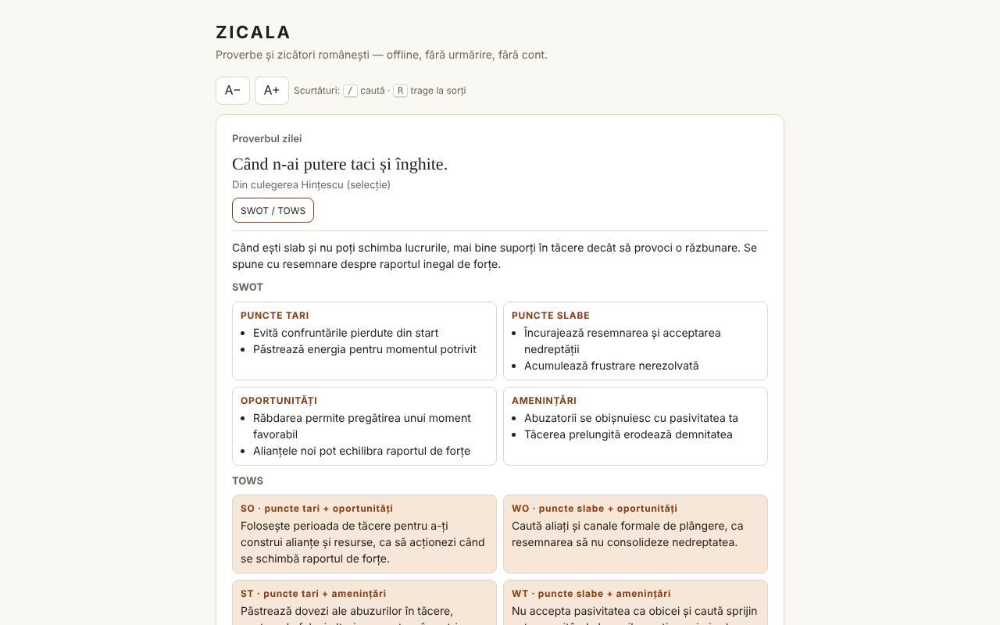

# ZICALA — proverbe românești

Colecție de 550 de proverbe și zicători românești într-un singur fișier HTML: proverbul zilei, tras la sorți, căutare, favorite și comentarii SWOT / TOWS.

**Live:** https://chiuta.github.io/Zicala/

## Ce este

ZICALA este o aplicație offline („fără frontiere”, trade-free): fără cont, fără urmărire, fără apeluri de rețea. Proverbele sunt grupate în 13 categorii (11 tematice, „Din culegerea Hințescu (selecție)” și „Alte culegeri online (selecție)”).

## Funcții

- Proverbul zilei: ales determinist după data locală; într-un ciclu de 550 de zile nu se repetă niciunul.
- „Trage la sorți”: parcurge toate proverbele în ordine aleatorie (amestecare Fisher–Yates), fără repetări până se termină tururile; buton „Copiază”.
- Căutare pe cuvinte (toate cuvintele trebuie să apară), insensibilă la diacritice și la majuscule: „tacerea” găsește „Tăcerea”.
- Filtru pe categorie și pe favorite; listă afișată progresiv (60 de rânduri, „Arată încă”).
- Favorite (★) și proverbe proprii (adăugare/ștergere), salvate local.
- Export al favoritelor și adăugirilor într-un fișier text.
- Pentru fiecare proverb, un panou „SWOT / TOWS” (interpretare editorială, vezi mai jos).

## Manual de utilizare

1. Deschide pagina; „Proverbul zilei” apare sus.
2. Apasă „Trage la sorți” pentru un proverb aleatoriu; „Favorit” îl salvează.
3. Scrie în „Caută” unul sau mai multe cuvinte; alege categoria sau „Favorite” din liste.
4. Apasă „SWOT / TOWS” lângă un proverb pentru a deschide sau închide comentariul.
5. Scrie un proverb în „Adaugă un proverb al tău” și apasă „Adaugă” (sau Enter); „Șterge” apare doar la proverbele tale.
6. „Exportă favoritele și adăugirile” descarcă `zicala-export.txt`.

## Confidențialitate și rețea

- Storage: `localStorage` (cheile `zf` pentru favorite, `zm` pentru proverbele adăugate), dacă browserul îl permite; altfel aplicația funcționează, dar nu păstrează datele și te avertizează. Nu se folosesc cookie-uri, `sessionStorage` sau IndexedDB.
- Rețea: niciun apel extern. Pagina are o politică CSP (`default-src 'none'`) care blochează orice conexiune sau resursă externă. Numele site-urilor din secțiunea „Surse” sunt doar text, nu linkuri.
- Permisiuni ale browserului: niciuna.

## Limite și avertismente

- **SWOT / TOWS sunt interpretări editoriale**, generate asistat de AI, ca exercițiu de reflecție. Nu sunt surse paremiologice sau istorice; sensul, originea („biblică”, „latină”) și atribuirile pot fi inexacte. Nu înlocuiesc sfatul medical, juridic sau financiar.
- Colecția nu este exhaustivă. Pentru categoria „Alte culegeri online” sursa exactă a fiecărui proverb nu este înregistrată (surse generale: ppli.ie, digitalpedia.ro, Enciclopedia comunei Șerbănești, proverbesicitate.blogspot.com, adevarul.ro). Categoria „Hințescu” provine din I. C. Hințescu, *Proverbele românilor* (via ro.wikisource.org, ortografie actualizată).
- Proverbele populare sunt anonime, din tradiția orală; comentariile și aranjările unor culegeri moderne pot fi protejate. Pentru corecții sau retrageri: alexio@trom.tf.
- Unele proverbe vechi conțin stereotipuri sau limbaj depășit; sunt păstrate ca documente de limbă, nu ca îndemnuri.

## Rulare locală / offline

Descarcă `index.html` și deschide-l în browser; nu are nevoie de server sau de internet.

## Licență

Licența nu este încă declarată.

## Istoric / Changelog

Ultima actualizare: 11 octombrie 2026 (aplicația nu are număr de versiune și nu afișează date de construire).
- Verificare de rutină: axe-core = 0 violări la 1280 și 360 px, 0 erori JS, fără depășire orizontală; proverbul zilei se calculează din data locală, deci nu necesită actualizare. Fără modificări de cod.

## Autor

Alexio — Alexandru-Ionuț Chiuță, contact: alexio@trom.tf

## English summary

ZICALA is a single-file, offline collection of 550 Romanian proverbs: daily proverb, random draw (Fisher–Yates), diacritic-insensitive search, favorites and user-added proverbs (localStorage, with graceful fallback). It makes no network requests (strict CSP) and requests no permissions. The per-proverb SWOT/TOWS panels are editorial, AI-assisted interpretations, not scholarly sources. Source attribution is general; per-item provenance is not recorded. No license declared yet.
