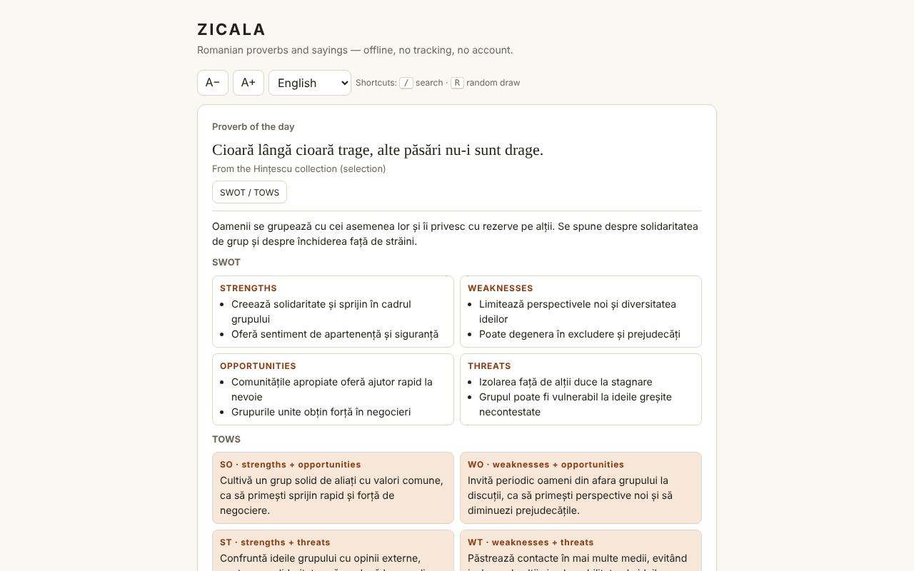

# ZICALA — Romanian proverbs

**English** · [Română](README.ro.md) · [Français](README.fr.md) · [Italiano](README.it.md) · [Español](README.es.md) · [Português](README.pt.md) · [Deutsch](README.de.md) · [Magyar](README.hu.md)

**Version:** 1.2.2 · **Last updated:** 2026-10-19

Interface languages: **Română, English, Français, Italiano, Español, Português (PT), Deutsch, Magyar**

A collection of 550 Romanian proverbs and sayings in a single HTML file: proverb of the day, random draw, search, favourites and SWOT / TOWS commentaries.

**Live:** https://chiuta.github.io/Zicala/

## What it is

ZICALA is an offline ("without borders", trade-free) application: no account, no tracking, no network calls. The proverbs are grouped into 13 categories (11 thematic ones, "From the Hințescu collection (selection)" and "Other online collections (selection)").

## Features

- Proverb of the day: chosen deterministically from the local date; within a cycle of 550 days none is repeated.
- "Draw at random": goes through all the proverbs in random order (Fisher–Yates shuffle), with no repeats until the rounds are finished; "Copy" button.
- Word search (all words must appear), insensitive to diacritics and letter case: "tacerea" finds "Tăcerea".
- Filter by category and by favourites; list displayed progressively (60 rows, "Show more").
- Favourites (★) and your own proverbs (add/delete), saved locally.
- Export of favourites and additions to a text file and import of the same file (adds, does not replace).
- "Copy" on every proverb in the list; text size A− / A+ (4 steps, remembered locally); keyboard shortcuts: `/` for search, `R` for "Draw at random" (not triggered while you are typing in a field).
- Printing: "Print list" (or Ctrl/Cmd+P) prints the whole currently filtered list (for example only the favourites), in black and white, without buttons.
- For each proverb, a "SWOT / TOWS" panel (editorial interpretation, see below).

## User guide

1. Open the page; the "Proverb of the day" appears at the top.
2. Press "Draw at random" for a random proverb; "Favourite" saves it.
3. Type one or more words in "Search"; choose the category or "Favourites" from the lists.
4. Press "SWOT / TOWS" next to a proverb to open or close the commentary.
5. Type a proverb in "Add a proverb of your own" and press "Add" (or Enter); "Delete" appears only on your own proverbs.
6. "Export favourites and additions" downloads `zicala-export.txt`; "Import (the exported file)" reloads it (for example in another browser).
7. "Copy" copies a proverb; A− / A+ changes the text size; "Print list" prepares the page for the printer (first choose "Favourites" to print only the favourites).

## Privacy and network

- Storage: `localStorage` (keys `zf` for favourites, `zm` for added proverbs, `zs` for text size), if the browser allows it; otherwise the app works but does not keep the data and warns you. No cookies, `sessionStorage` or IndexedDB are used.
- Network: no external calls. The page has a CSP policy (`default-src 'none'`, scripts only by hash, no `'unsafe-inline'` for scripts) that blocks any external connection or resource. The names of the sites in the "Sources" section are plain text, not links.
- Browser permissions: none.

## Limits and warnings

- **SWOT / TOWS are editorial interpretations**, generated with AI assistance, as an exercise in reflection. They are not paremiological or historical sources; the meaning, the origin ("biblical", "Latin") and the attributions may be inaccurate. They do not replace medical, legal or financial advice.
- The collection is not exhaustive. For the "Other online collections" category the exact source of each proverb is not recorded (general sources: ppli.ie, digitalpedia.ro, Enciclopedia comunei Șerbănești, proverbesicitate.blogspot.com, adevarul.ro). The "Hințescu" category comes from I. C. Hințescu, *Proverbele românilor* (via ro.wikisource.org, updated spelling).
- Folk proverbs are anonymous, from the oral tradition; the commentaries and arrangements of some modern collections may be protected. For corrections or withdrawals: alexio@trom.tf.
- Some old proverbs contain stereotypes or outdated language; they are kept as documents of the language, not as exhortations.

## Running locally / offline

Download `index.html` and open it in a browser; it needs no server or internet.

## License

The license has not been declared yet.

## History / Changelog

- 1.1.0 — 2026-10-14: Backup and data labelling (fff-kit).

- 1.0.0 — 2026-10-12: the version and the date of the last update are shown in the app (first numbered version; in the info card below the list).

Round 7:
- **Import:** the "Import (the exported file)" button reads `zicala-export.txt` (the `FAVORITE` and `ADĂUGATE DE MINE` sections) and **adds** the favourites (only for proverbs existing in the collection or just imported) and the new proverbs of your own; it deletes nothing, ignores duplicates, respects the limits (8–300 characters, file ≤ 200 KB) and shows how many were added/skipped. Previously, the export could not be reloaded (data could not be moved between browsers). CSP hash recalculated; axe-core = 0 violations at 1280 and 360 px.
- The content (proverbs, SWOT/TOWS) was not modified.

Round 6:
- New: "Copy" on every row, A− / A+, shortcuts `/` and `R`, "Print list" with print styling. CSP: the script is now allowed by hash instead of `'unsafe-inline'`. The SWOT/TOWS panels use `h3` (correct heading order); the category list no longer overflows the 360 px screen with enlarged text. Screenshot refreshed.
- Routine check: axe-core = 0 violations at 1280 and 360 px, 0 JS errors, no horizontal overflow; the proverb of the day is computed from the local date, so it needs no updating. No code changes.

## Author

Alexio — Alexandru-Ionuț Chiuță, contact: alexio@trom.tf

## Summary

ZICALA is a single-file, offline collection of 550 Romanian proverbs: daily proverb, random draw (Fisher–Yates), diacritic-insensitive search, favorites and user-added proverbs (localStorage, with graceful fallback). It makes no network requests (strict CSP) and requests no permissions. The per-proverb SWOT/TOWS panels are editorial, AI-assisted interpretations, not scholarly sources. Source attribution is general; per-item provenance is not recorded. No license declared yet.
