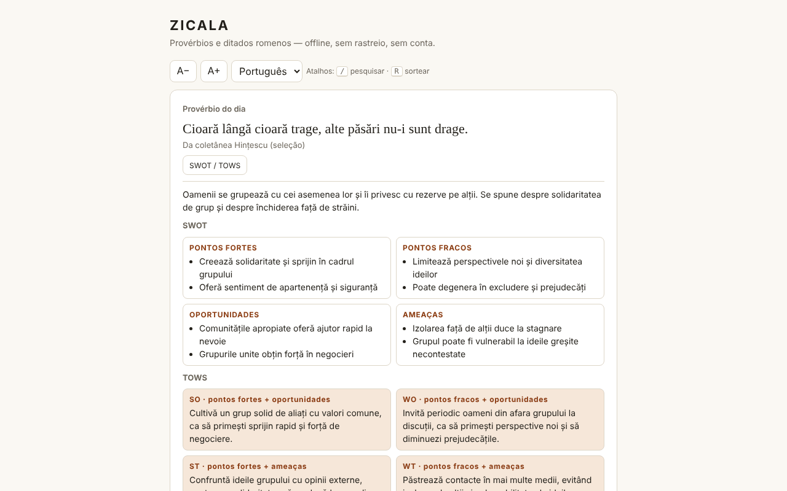

# ZICALA — provérbios romenos

[English](README.md) · [Română](README.ro.md) · [Français](README.fr.md) · [Italiano](README.it.md) · [Español](README.es.md) · **Português** · [Deutsch](README.de.md) · [Magyar](README.hu.md)

**Versão:** 1.2.1 · **Última atualização:** 2026-10-19

Idiomas da interface: **Română, English, Français, Italiano, Español, Português (PT), Deutsch, Magyar**

Uma coleção de 550 provérbios e ditados romenos num único ficheiro HTML: provérbio do dia, sorteio ao acaso, pesquisa, favoritos e comentários SWOT / TOWS.

**Online:** https://chiuta.github.io/Zicala/

## O que é

A ZICALA é uma aplicação offline («sem fronteiras», trade-free): sem conta, sem rastreio, sem chamadas de rede. Os provérbios estão agrupados em 13 categorias (11 temáticas, «Da coletânea Hințescu (seleção)» e «Outras coletâneas online (seleção)»).

## Funcionalidades

- Provérbio do dia: escolhido de forma determinista pela data local; num ciclo de 550 dias nenhum se repete.
- «Sortear»: percorre todos os provérbios por ordem aleatória (mistura de Fisher–Yates), sem repetições até terminarem as voltas; botão «Copiar».
- Pesquisa por palavras (todas têm de aparecer), insensível a diacríticos e a maiúsculas: «tacerea» encontra «Tăcerea».
- Filtro por categoria e por favoritos; lista apresentada progressivamente (60 linhas, «Mostrar mais»).
- Favoritos (★) e provérbios próprios (adicionar/eliminar), guardados localmente.
- Exportação dos favoritos e dos acrescentos para um ficheiro de texto e importação do mesmo ficheiro (acrescenta, não substitui).
- «Copiar» em cada provérbio da lista; tamanho do texto A− / A+ (4 níveis, memorizado localmente); atalhos de teclado: `/` para pesquisar, `R` para «Sortear» (não é acionado enquanto escreve num campo).
- Impressão: «Imprimir a lista» (ou Ctrl/Cmd+P) imprime toda a lista atualmente filtrada (por exemplo, só os favoritos), a preto e branco, sem botões.
- Para cada provérbio, um painel «SWOT / TOWS» (interpretação editorial, ver abaixo).

## Manual de utilização

1. Abra a página; o «Provérbio do dia» aparece no topo.
2. Prima «Sortear» para um provérbio aleatório; «Favorito» guarda-o.
3. Escreva uma ou mais palavras em «Pesquisar»; escolha a categoria ou «Favoritos» nas listas.
4. Prima «SWOT / TOWS» junto de um provérbio para abrir ou fechar o comentário.
5. Escreva um provérbio em «Adicione um provérbio seu» e prima «Adicionar» (ou Enter); «Eliminar» aparece apenas nos seus próprios provérbios.
6. «Exportar favoritos e acrescentos» descarrega `zicala-export.txt`; «Importar (o ficheiro exportado)» volta a carregá-lo (por exemplo, noutro navegador).
7. «Copiar» copia um provérbio; A− / A+ altera o tamanho do texto; «Imprimir a lista» prepara a página para a impressora (escolha primeiro «Favoritos» para imprimir só os favoritos).

## Privacidade e rede

- Armazenamento: `localStorage` (chaves `zf` para os favoritos, `zm` para os provérbios adicionados, `zs` para o tamanho do texto), se o navegador o permitir; caso contrário, a aplicação funciona, mas não guarda os dados e avisa-o. Não são usados cookies, `sessionStorage` nem IndexedDB.
- Rede: nenhuma chamada externa. A página tem uma política CSP (`default-src 'none'`, scripts apenas por hash, sem `'unsafe-inline'` para scripts) que bloqueia qualquer ligação ou recurso externo. Os nomes dos sites na secção «Fontes» são apenas texto, não ligações.
- Permissões do navegador: nenhuma.

## Limites e avisos

- **Os SWOT / TOWS são interpretações editoriais**, geradas com assistência de IA, como exercício de reflexão. Não são fontes paremiológicas nem históricas; o sentido, a origem («bíblica», «latina») e as atribuições podem ser inexatos. Não substituem aconselhamento médico, jurídico ou financeiro.
- A coleção não é exaustiva. Para a categoria «Outras coletâneas online» não está registada a fonte exata de cada provérbio (fontes gerais: ppli.ie, digitalpedia.ro, Enciclopedia comunei Șerbănești, proverbesicitate.blogspot.com, adevarul.ro). A categoria «Hințescu» provém de I. C. Hințescu, *Proverbele românilor* (através de ro.wikisource.org, ortografia atualizada).
- Os provérbios populares são anónimos, de tradição oral; os comentários e as organizações de algumas coletâneas modernas podem estar protegidos. Para correções ou retiradas: alexio@trom.tf.
- Alguns provérbios antigos contêm estereótipos ou linguagem ultrapassada; são mantidos como documentos da língua, não como exortações.

## Execução local / offline

Descarregue `index.html` e abra-o no navegador; não precisa de servidor nem de internet.

## Licença

A licença ainda não está declarada.

## Histórico / Changelog

- 1.1.0 — 2026-10-14: cópia de segurança e etiquetagem de dados (fff-kit).

- 1.0.0 — 2026-10-12: a versão e a data da última atualização são apresentadas na aplicação (primeira versão numerada; no cartão informativo abaixo da lista).

Ronda 7:
- **Importação:** o botão «Importar (o ficheiro exportado)» lê `zicala-export.txt` (as secções `FAVORITE` e `ADĂUGATE DE MINE`) e **acrescenta** os favoritos (apenas para provérbios existentes na coleção ou acabados de importar) e os novos provérbios próprios; não elimina nada, ignora duplicados, respeita os limites (8–300 carateres, ficheiro ≤ 200 KB) e indica quantos foram adicionados/omitidos. Antes, a exportação não podia ser recarregada (os dados não podiam ser movidos entre navegadores). Hash CSP recalculado; axe-core = 0 violações a 1280 e 360 px.
- O conteúdo (provérbios, SWOT/TOWS) não foi modificado.

Ronda 6:
- Novo: «Copiar» em cada linha, A− / A+, atalhos `/` e `R`, «Imprimir a lista» com estilo de impressão. CSP: o script passou a ser permitido por hash em vez de `'unsafe-inline'`. Os painéis SWOT/TOWS usam `h3` (ordem correta dos títulos); a lista de categorias já não excede o ecrã de 360 px com o texto ampliado. Captura de ecrã renovada.
- Verificação de rotina: axe-core = 0 violações a 1280 e 360 px, 0 erros JS, sem excesso horizontal; o provérbio do dia é calculado a partir da data local, pelo que não precisa de atualização. Sem alterações de código.

## Autor

Alexio — Alexandru-Ionuț Chiuță, contacto: alexio@trom.tf

## Resumo

A ZICALA é uma coleção offline, de ficheiro único, com 550 provérbios romenos: provérbio do dia, sorteio (Fisher–Yates), pesquisa insensível a diacríticos, favoritos e provérbios adicionados pelo utilizador (localStorage, com degradação suave). Não faz pedidos de rede (CSP estrita) e não solicita permissões. Os painéis SWOT/TOWS de cada provérbio são interpretações editoriais assistidas por IA, não fontes académicas. A atribuição de fontes é geral; a proveniência de cada item não está registada. Ainda não foi declarada nenhuma licença.
